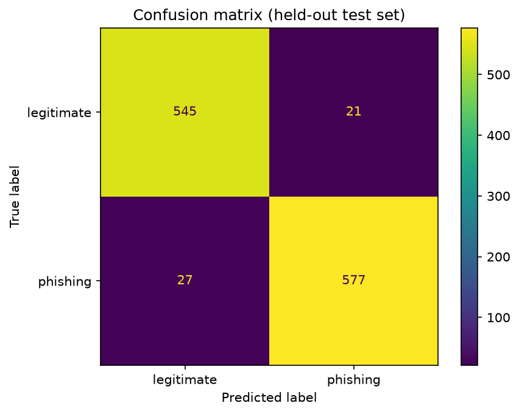
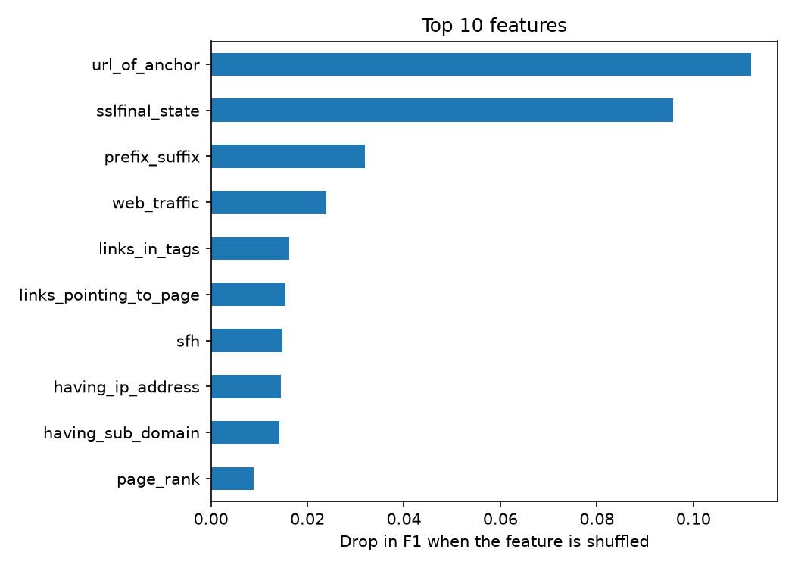

# Phishing Website Classifier

A machine learning classifier that flags phishing websites from 30 URL, domain and page-based features.

## Results (held-out test set, 1,170 sites)

| Metric | Score |
|---|---|
| Accuracy | 95.9% |
| Precision | 96.5% |
| Recall | 95.5% |
| ROC-AUC | 0.9935 |

Confusion matrix: 545 legitimate correctly cleared, 21 false alarms, 27 missed phishing sites, 577 phishing sites caught. Phishing is the positive class.



## Data

UCI Machine Learning Repository, Phishing Websites dataset (11,055 sites, 30 features coded -1, 0 or 1). About 47% of the rows (5,206) were exact duplicates. I removed them before splitting to prevent train/test leakage, leaving 5,849 unique sites. The original label -1 (phishing) is recoded as 1.

## Method

1. Removed duplicates, then made a stratified 80/20 train/test split (random_state=42).
2. Compared four models with 5-fold stratified cross-validation on the training set only:

| Model | CV F1 |
|---|---|
| Gradient Boosting | 0.952 |
| Random Forest | 0.949 |
| Logistic Regression | 0.923 |
| Decision Tree | 0.922 |

3. Tuned gradient boosting with randomized search (25 iterations, scored on F1). Best settings: `learning_rate=0.1, max_iter=200, max_depth=5, max_leaf_nodes=15, min_samples_leaf=40, l2_regularization=0`. Best cross-validated F1: 0.9553.

4. Evaluated once on the untouched test set.

## Most important features

Permutation importance showed that `url_of_anchor` and `sslfinal_state` matter most, followed by `prefix_suffix`, `web_traffic` and `links_in_tags`.



## Limitations

- The features are precomputed in the dataset, so the project does not yet turn a raw URL into a prediction.
- The dataset is dated and small after de-duplication, so results may not generalize to current phishing sites.
- Some features, like web traffic and page rank, would need external lookups in a real service.

## Run it

```
pip install -r requirements.txt
```

Open `notebooks/phishing_classifier.ipynb` and run all cells.